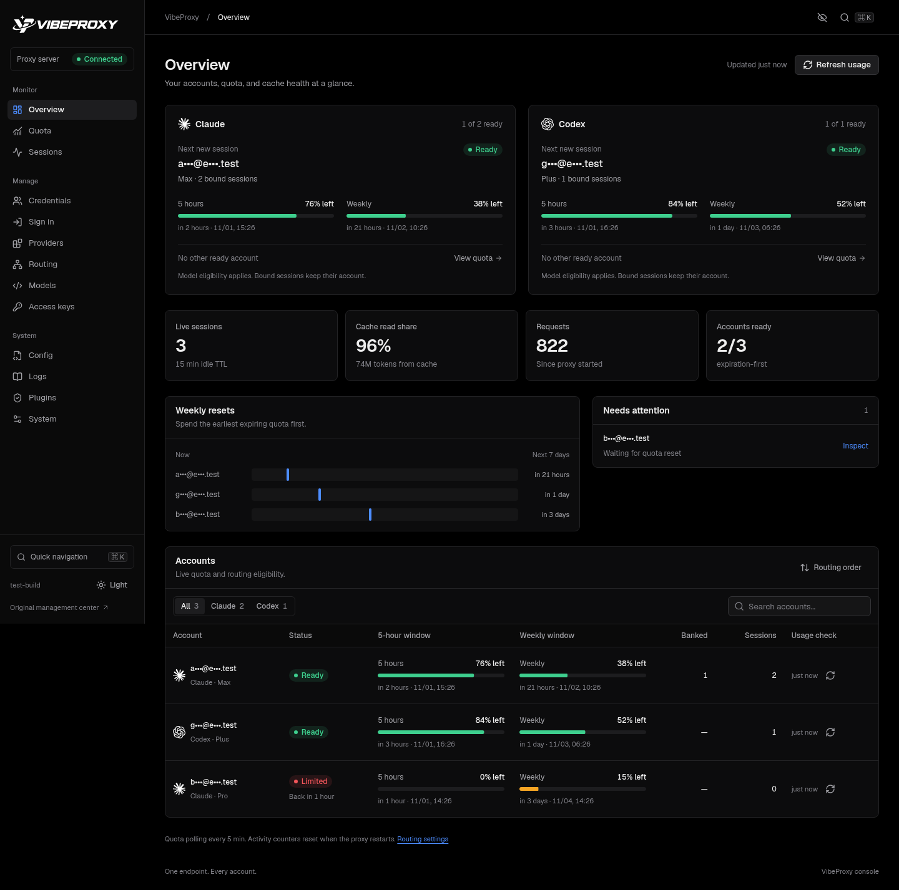
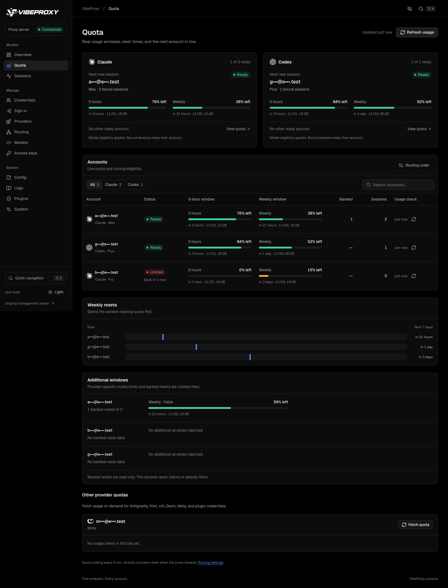
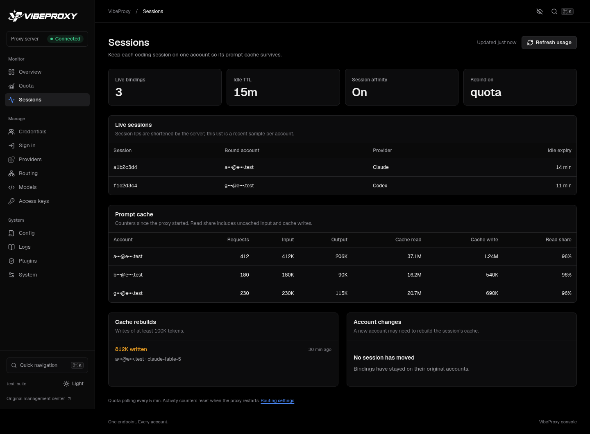
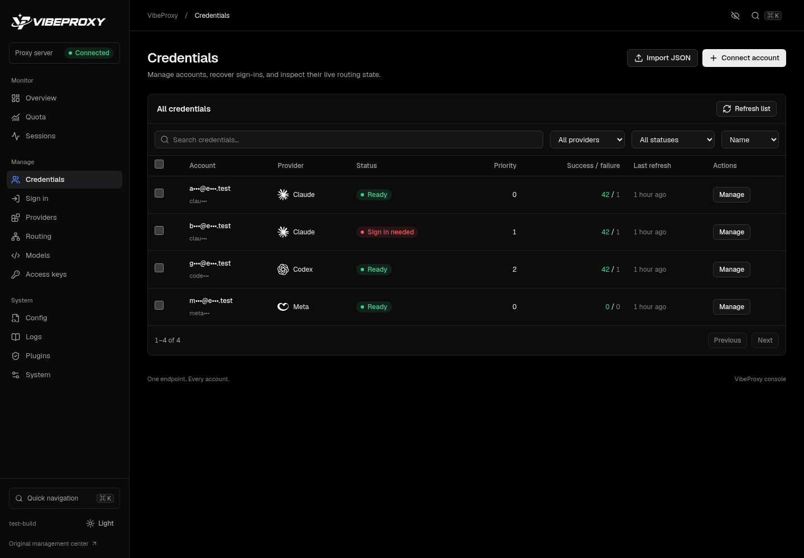
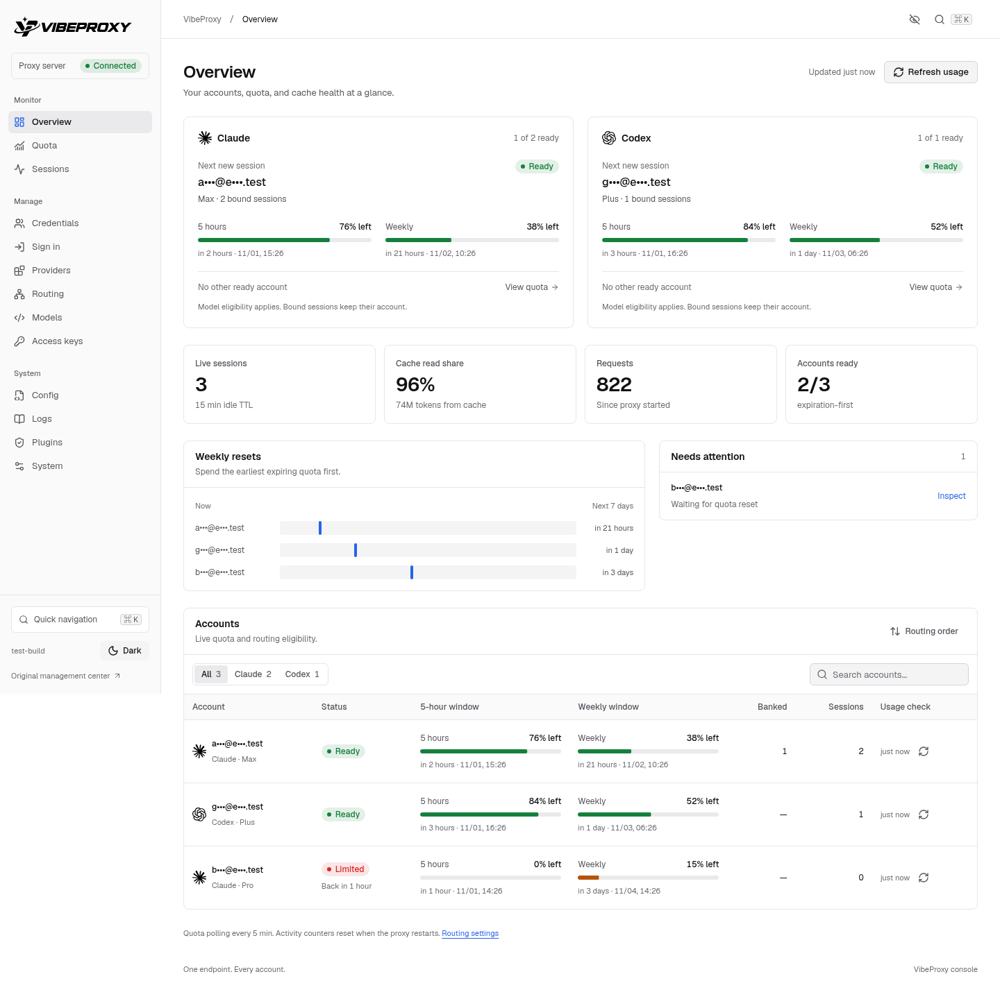
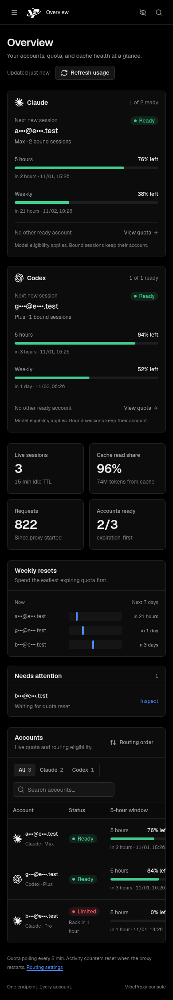

<picture>
  <source media="(prefers-color-scheme: dark)" srcset="assets/logo/vibeproxy-wordmark-white.svg">
  
</picture>

# VibeProxy · VPXY

One local endpoint for your Claude, Codex, and other AI accounts, with quota-aware routing
and a built-in management console.

VPXY is a personal fork of [CLIProxyAPI](https://github.com/router-for-me/CLIProxyAPI), based on
upstream commit `dbb706215a3a`. It adds expiration-first account selection, sticky coding
sessions, real subscription quota monitoring, and a redesigned management dashboard.

[Download a release](https://github.com/sxnistxr/vpxy/releases/latest) ·
[Console features](docs/DASHBOARD.md) · [Management API](docs/management-api-v8.md)

## Console preview

These are screenshots of the working console with **synthetic sample data**. Account identities
are masked; the captures contain no live credentials or account details. Click an image to see
it at full resolution.

### Accounts, quota, and routing at a glance

[](assets/screenshots/overview-dark.png)

<table>
  <tr>
    <td width="50%" valign="top">
      <strong>Quota windows and reset times</strong><br><br>
      <a href="assets/screenshots/quota.png"></a>
    </td>
    <td width="50%" valign="top">
      <strong>Session affinity and prompt cache</strong><br><br>
      <a href="assets/screenshots/sessions-cache.png"></a>
    </td>
  </tr>
</table>

<details>
<summary>Credentials, light theme, and mobile screenshots</summary>

### Credential management

[](assets/screenshots/credentials.png)

### Light theme

[](assets/screenshots/overview-light.png)

### On your phone

<a href="assets/screenshots/overview-mobile.png"></a>

</details>

## Features

- **Expiration-first routing.** Within the highest eligible priority tier, new sessions use the
  account whose weekly quota resets soonest. Rate limits and authentication errors trigger failover.
- **Session affinity.** Sliding idle expiration keeps a coding session on one account so its
  prompt cache survives. The starter config uses a 15-minute TTL and quota/authentication rebinding.
- **Live quotas.** Claude and Codex usage endpoints plus upstream rate-limit headers supply
  5-hour, weekly, and model-specific windows. Banked resets are tracked without being spent.
- **Cache visibility.** Per-account cache reads, writes, rebuild events, and binding changes
  help identify costly cache resets. Activity counters cover the current server process.
- **Codex WebSockets.** OAuth accounts use the upstream WebSocket path by default, with OAuth
  tokens and the ChatGPT account ID injected by the proxy.
- **Complete management console.** Thirteen pages cover overview, quota, sessions, credentials,
  OAuth, providers, routing, models, client keys, config, logs, plugins, and system tools.
- **Local and tailnet access.** Trusted-network requests can authenticate without a key, with
  Host/Origin checks. Other clients need configured access keys and management credentials.
- **A self-contained executable.** The branded dark/light dashboard is embedded in the binary.
  Bun and Node are needed only for dashboard development, not to run a release.

The existing OpenAI-, Anthropic-, Gemini-, and Codex-compatible APIs, storage backends, provider
integrations, and plugin architecture remain available. See the [upstream guide](docs/UPSTREAM_README.md).

## Download

Choose an archive from [Releases](https://github.com/sxnistxr/vpxy/releases). Release assets use
`vpxy_<version>_<os>_<arch>` names, with ZIP archives on Windows and tar.gz elsewhere.

| System | Architecture | Archive suffix | Executable |
| --- | --- | --- | --- |
| Windows | Intel/AMD x64 | `windows_amd64.zip` | `vpxy.exe` |
| Windows | ARM64 | `windows_arm64.zip` | `vpxy.exe` |
| Linux | Intel/AMD x64 | `linux_amd64.tar.gz` | `vpxy` |
| Linux | ARM64 | `linux_arm64.tar.gz` | `vpxy` |
| macOS | Intel | `darwin_amd64.tar.gz` | `vpxy` |
| macOS | Apple Silicon | `darwin_arm64.tar.gz` | `vpxy` |

Native releases are built with CGO enabled to retain dynamic-library plugin support. Linux
releases are built on Ubuntu 24.04. Each archive includes the executable, starter and full
reference configurations, documentation, license, and build metadata. `checksums.txt` contains
SHA-256 hashes for all six archives. macOS binaries are not notarized.

## Quick start

Extract an archive, open a terminal in its directory, and create your configuration.

**Linux and macOS**

```sh
cp config.example.yaml config.yaml
./vpxy --config config.yaml
```

**Windows PowerShell**

```powershell
Copy-Item config.example.yaml config.yaml
.\vpxy.exe --config config.yaml
```

Open **[http://localhost:8317/management.html](http://localhost:8317/management.html)** and choose
**Sign in** to connect Claude or Codex. The starter configuration binds to localhost, enables
trusted networks, and uses expiration-first routing with 15-minute affinity. Import existing
credential JSON files through **Credentials** if you already have them.

Alternatively, sign in from a second terminal:

```sh
./vpxy --config config.yaml --claude-login
./vpxy --config config.yaml --codex-login
# Headless browser flow: add --no-browser
# Codex device flow: use --codex-device-login
```

On Windows, replace `./vpxy` with `.\vpxy.exe`. Credentials default to `~/.cli-proxy-api` and are
picked up by the running proxy. Keep that directory and your `config.yaml` when upgrading.
The original management center is available at `/management-center.html`.

When running from source, first copy `config.vpxy.example.yaml` to `config.yaml`. The repository's
`config.example.yaml` contains the complete upstream reference; release archives call it
`config.reference.yaml`.

## Connect your clients

**Claude Code**

```sh
export ANTHROPIC_BASE_URL=http://localhost:8317
```

For PowerShell, use `$env:ANTHROPIC_BASE_URL = "http://localhost:8317"`.

**Codex** — in `~/.codex/config.toml`:

```toml
openai_base_url = "http://localhost:8317/backend-api/codex"
```

The built-in provider retains WebSocket support. A custom provider can use:

```toml
model_provider = "vpxy"

[model_providers.vpxy]
name = "VPXY"
base_url = "http://localhost:8317/v1"
wire_api = "responses"
supports_websockets = true
```

**Other OpenAI-compatible clients:** use `http://localhost:8317/v1` as the base URL and a client
access key configured in the console when authentication is required.

## Configuration and Tailscale

The starter profile includes:

```yaml
trusted-networks:
  enabled: true

quota-monitor:
  interval: 5m
  rebuild-alert-tokens: 100000

routing:
  strategy: expiration-first
  session-affinity: true
  session-affinity-ttl: 15m
  session-affinity-rebind-on: quota

oauth:
  providers:
    codex:
      oauth-websockets: true
```

To connect from another device on your tailnet, install Tailscale on both devices, set
`server.host` to `""` in `config.yaml`, restart VPXY, and replace `localhost` in the client URLs
with this machine's Tailscale name or address. The default trusted ranges are `127.0.0.0/8`,
`::1/128`, `100.64.0.0/10`, and `fd7a:115c:a1e0::/48`. Forwarded headers do not establish trust.

For other networks, configure client keys under `access.api-keys`, a management key under
`management.secret-key` or `MANAGEMENT_PASSWORD`, and `management.allow-remote` when remote
management is needed. Runtime config, account tokens, and `.env` files are excluded from Git.

## Build from source

Requires Go 1.26.10 or newer. Native plugin support also requires a C compiler.

```sh
git clone https://github.com/sxnistxr/vpxy.git
cd vpxy
cp config.vpxy.example.yaml config.yaml
go build -o vpxy ./cmd/server
./vpxy --config config.yaml
```

On Windows, build with `go build -o vpxy.exe ./cmd/server`. The checked-in embedded console
lets Go builds run without frontend tooling. To change the dashboard, install Bun and run:

```sh
cd dashboard
bun install --frozen-lockfile
bun run check
bun test
bun run build
bunx playwright install chromium # one-time browser setup
bun run verify
```

Then rebuild the Go executable. Browser verification uses isolated fixtures and includes
accessibility checks, mobile layout, authentication, OAuth, and management interactions.

Focused backend checks:

```sh
go test ./internal/api/... ./internal/config/... ./internal/quota/... ./internal/access/... ./sdk/cliproxy/...
```

The full `go test ./...` currently has an upstream-reproducible failure in
`TestResponsesInterruptStopsHTTPUpstream`; details are in [the console guide](docs/DASHBOARD.md).

## Build and publish releases

Pushing a version tag such as `v0.1.0` starts `.github/workflows/release.yaml`. The workflow
builds and smoke-tests x64/ARM64 binaries on native Windows, Linux, and macOS runners,
verifies all six archives, generates checksums, and publishes the complete GitHub release.

To build an archive locally with Python 3.11+ and Go:

```sh
python3 scripts/release.py build --version v0.1.0 --target linux-amd64 --smoke
python3 scripts/release.py checksums
```

Use the matching native OS/architecture for `--smoke`. `--portable` builds without CGO for
cross-compilation or systems that cannot use the native build; Unix dynamic plugins are
unavailable in those portable builds. Build metadata records the version, commit, target,
CGO setting, and build time.

## License

[MIT](LICENSE). Original CLIProxyAPI copyright and license notices are retained.
